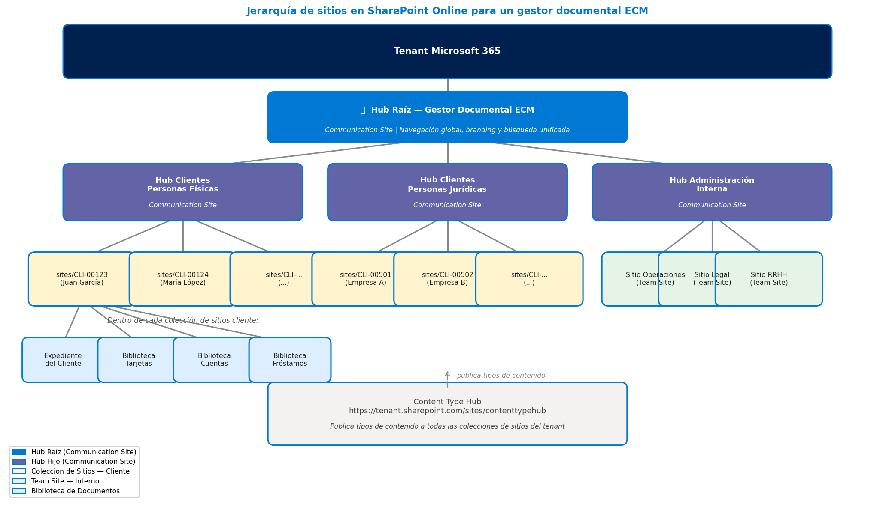
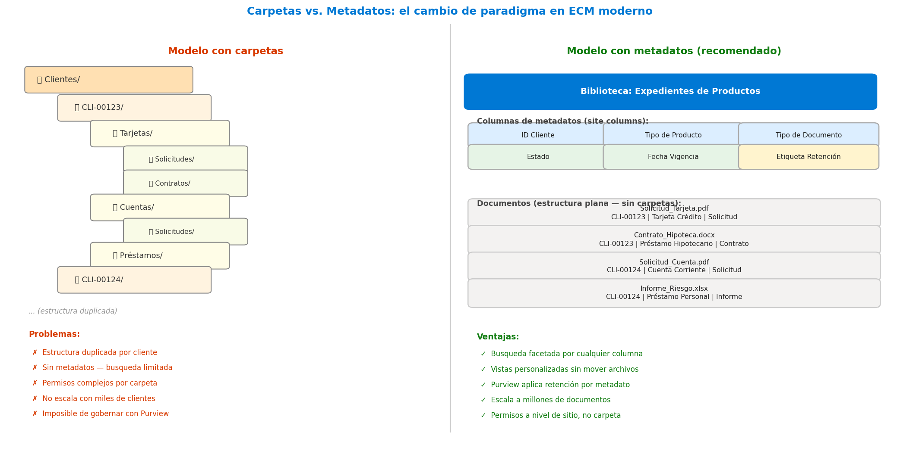

# Estructura Documental en SharePoint Online: la base sobre la que se sostiene todo lo demás

**Resumen:** En este artículo les presento la arquitectura de contenido que da sustento al gestor documental empresarial que vamos construyendo en la serie. Cubrimos la jerarquía de sitios modernos en SharePoint Online —Communication Sites vs. Team Sites, hub sites como concentradores, colecciones de sitios como unidad de aislamiento—, el rol del Content Type Hub en la herencia de tipos de contenido, y el cambio de paradigma más importante: organizar con metadatos en lugar de carpetas. Aunque el escenario de referencia es el sector financiero, todo lo que vemos acá aplica a cualquier organización que quiera construir una base documental que escale y se pueda gobernar.

---

Antes de configurar una sola política de retención, antes de activar Purview o de pensar en qué licencias necesitamos, hay una decisión que impacta todo lo demás: cómo organizamos los contenidos dentro de SharePoint Online. La estructura documental no es un detalle técnico que se resuelve solo; es una decisión de arquitectura que, si se hace mal al principio, cuesta carísimo corregir después. Lo vi en más de un proyecto: la presión por arrancar lleva a crear carpetas en cualquier biblioteca, a poner todo en un sitio de Teams que tenía otro propósito, y tres meses después nadie encuentra nada y los permisos son un desastre.

En este artículo les cuento cómo pienso la estructura documental para un gestor ECM sobre SharePoint Online: desde la elección del tipo de sitio hasta el modelo de metadatos que reemplaza a las carpetas, pasando por hub sites, colecciones de sitios y tipos de contenido. El caso que uso como referencia es el del sector financiero, que aparece en el Artículo 0 de esta serie, pero las decisiones de diseño aplican igual en una clínica, una aseguradora o un organismo público.

---

## ¿Communication Site o Team Site? La primera decisión de arquitectura

SharePoint Online tiene dos tipos de sitio raíz: Communication Sites y Team Sites. No son intercambiables y elegir el equivocado para cada propósito genera problemas de gobernabilidad desde el día uno.

Los Communication Sites están diseñados para publicar contenido hacia una audiencia amplia. No tienen un grupo de Microsoft 365 asociado por defecto, no crean un equipo de Teams automáticamente, y el modelo de permisos es simple: hay dueños del sitio y hay lectores. Son el sitio correcto para portales internos, hubs de documentación corporativa y páginas de referencia que muchos visitan pero pocos editan.

Los Team Sites están pensados para la colaboración dentro de un equipo de trabajo. Crean automáticamente un grupo de Microsoft 365 (con buzón, calendario y equipo de Teams incluidos), lo que los hace el candidato natural para el trabajo diario en proyectos o áreas funcionales. En un gestor documental ECM, los Team Sites son el lugar donde los operadores documentales van a cargar, clasificar y trabajar con los expedientes.

| Característica | Communication Site | Team Site |
|---|---|---|
| Audiencia | Muchos lectores, pocos editores | Equipo de trabajo colaborativo |
| Grupo M365 | No (por defecto) | Sí (buzón, calendario, Teams) |
| Uso típico ECM | Hub raíz, portal documental, centro de referencia | Sitio por cliente / expediente activo |
| Permisos | Simples: dueños y visitantes | Granulares: miembros, propietarios, invitados |
| Asociación a hub | Puede ser hub raíz o asociado | Puede asociarse a un hub |

---

## Hub Sites: concentradores que conectan sin fusionar

Los hub sites son uno de los conceptos que más confusión generan, sobre todo a quienes vienen de SharePoint Server on-premises donde todo era cuestión de colecciones de sitios y subcolecciones. En SharePoint Online un hub site no es un contenedor que alberga a los demás; es un nodo de navegación, búsqueda y tema visual que asocia sitios entre sí sin tocar su estructura de permisos.

La arquitectura de hub sites en Microsoft 365 soporta hasta tres niveles: un hub raíz que puede tener hubs hijo, y cada hub hijo puede tener sitios asociados. La asociación no crea una jerarquía de contenido, crea una superficie común de navegación y búsqueda. Cuando un usuario busca desde el hub raíz, la búsqueda recorre todos los sitios asociados al árbol, lo que es exactamente lo que necesitamos en un gestor documental donde el operador tiene que poder encontrar un expediente sin saber en cuál de los cientos de colecciones de sitios está.

Para el escenario financiero del Artículo 0, lo armo así: un Communication Site como hub raíz del gestor documental, dos hubs hijo (uno para Personas Físicas y otro para Personas Jurídicas), y bajo cada hub hijo los Team Sites de cada cliente. La Imagen 1 muestra esta jerarquía completa.

*Imagen 1.- Jerarquía de sitios del gestor ECM: hub raíz (Communication Site) → hubs hijo por tipo de cliente → colecciones de sitios por cliente → bibliotecas de documentos. El Content Type Hub publica los tipos de contenido hacia toda la plataforma.*

---

## Colección de sitios por cliente: la unidad de aislamiento

Retomando el patrón que presenté en el Artículo 0 de esta serie: en un gestor documental a escala, cada entidad principal —cliente, proveedor, caso, expediente— debe tener su propia colección de sitios. Esta decisión no es arbitraria; responde a tres razones técnicas concretas.

Primero, el aislamiento de permisos. En SharePoint Online los permisos se administran dentro de una colección de sitios, y el modelo de seguridad garantiza que los permisos de una colección no afectan a otra. Si el operador A atiende a los clientes del área norte y el operador B al área sur, puedo asignar permisos a nivel de colección de sitios sin riesgo de que uno vea lo del otro.

Segundo, el ciclo de vida independiente. Cuando un cliente cierra su relación con la institución, el sitio puede archivarse o eliminarse sin tocar los datos de ningún otro cliente. Trabajar todo en un sitio compartido hace que cualquier operación de ciclo de vida sea quirúrgica y arriesgada.

Tercero, la cuota de almacenamiento. SharePoint Online permite asignar cuotas de almacenamiento por colección de sitios, lo que da visibilidad sobre qué clientes o entidades consumen más espacio y ayuda a tomar decisiones de archivado.

El patrón de URL que uso es `https://tenant.sharepoint.com/sites/{ID-ENTIDAD}`, donde `{ID-ENTIDAD}` es el identificador único del cliente o expediente. Con esto la URL es predecible, lo que facilita la automatización con Power Automate y las integraciones via Microsoft Graph.

---

## Bibliotecas de documentos: una por tipo de proceso

Dentro de cada colección de sitios, la organización de las bibliotecas de documentos es el segundo nivel de la arquitectura. La tentación natural es crear una sola biblioteca grande y usar carpetas para separar los tipos de documentos. Es el error más común que veo en implementaciones de SharePoint, y tiene un costo que aparece cuando ya es tarde.

El enfoque correcto es crear una biblioteca de documentos por cada tipo de proceso o producto. Cada biblioteca tiene sus propios tipos de contenido, sus propias columnas de metadatos y sus propias políticas de retención. Con este diseño, cuando Purview aplica una política de retención sobre "contratos de préstamos hipotecarios", trabaja solo sobre esa biblioteca, con las reglas exactas que corresponden a ese tipo de documento.

Para el escenario financiero, la estructura de bibliotecas dentro del sitio de cada cliente queda así:

| Biblioteca | Tipo de contenido principal | Responsabilidad concreta |
|---|---|---|
| Expediente del Cliente | Conjunto de Documentos (por año) | Documentación de identidad, KYC y correspondencia general del cliente, organizada por período anual |
| Tarjetas | Documento de Tarjeta | Solicitudes, contratos y estados de cuenta de tarjetas de crédito y débito |
| Cuentas Corrientes | Documento de Cuenta | Contratos de apertura, extractos y documentación operativa de cuentas |
| Préstamos Personales | Documento de Préstamo | Solicitudes, liquidaciones, tablas de amortización y garantías |
| Préstamos Hipotecarios | Documento Hipotecario | Escrituras, tasaciones, pólizas de seguro y contratos hipotecarios |

**El Expediente del Cliente y los Conjuntos de Documentos**

La biblioteca "Expediente del Cliente" tiene un rol diferente al resto: no organiza documentos por tipo de producto sino la documentación general del cliente, y su ciclo de vida está ligado al cliente, no a un producto específico. Para organizar esa documentación a lo largo del tiempo uso Conjuntos de Documentos (Document Sets) de SharePoint —uno por año—. Un Conjunto de Documentos es un tipo de contenido especial que agrupa varios archivos bajo una entidad común con propiedades propias, página de portada configurable y metadatos que se propagan a todos los documentos que lo componen.

Así, dentro de la biblioteca "Expediente del Cliente" de un sitio tengo los conjuntos "2023", "2024", "2025", cada uno con sus metadatos de período, estado y responsable, y dentro los archivos individuales de ese año: renovaciones de identidad, actualizaciones de domicilio, formularios KYC anuales. Esto permite aplicar retención a nivel del conjunto completo y tener una vista limpia por período sin recurrir a carpetas.

**Referencias cruzadas con vínculos a documentos**

Desde las bibliotecas de productos (Tarjetas, Préstamos, etc.) es habitual necesitar referenciar un documento del Expediente del Cliente —por ejemplo, el documento de identidad que ya está cargado en la biblioteca del cliente—. Crear una copia en cada biblioteca es un error: generaría duplicados desactualizados y haría imposible gobernar cuál es la versión vigente.

SharePoint Online resuelve esto con vínculos a documentos (document links): en lugar de copiar el archivo, se inserta en la biblioteca de destino un elemento que apunta al documento original en el Expediente del Cliente. El operador lo ve en la biblioteca de Tarjetas como si fuera un documento más, pero en realidad es una referencia al original. Si el cliente actualiza su documento de identidad, el vínculo sigue apuntando al archivo correcto sin ningún trabajo adicional.

También permite configurar vistas personalizadas por biblioteca: el operador de tarjetas ve solo los documentos de tarjetas, con los metadatos relevantes para su tarea, sin ruido de los otros productos. Cuando todo está en una sola biblioteca con carpetas, las vistas se complican, el rendimiento baja y la experiencia de usuario empeora.

---

## Content Type Hub: herencia de tipos de contenido en toda la plataforma

El Content Type Hub es un sitio especial de SharePoint Online desde el cual se publican los tipos de contenido hacia el resto del tenant. Cuando publico un tipo de contenido desde el Content Type Hub, SharePoint lo propaga automáticamente a todas las colecciones de sitios que lo soliciten, garantizando consistencia en toda la plataforma.

Para el gestor ECM, esto es crítico. Si tengo trescientas colecciones de sitios (una por cliente) y necesito agregar un nuevo campo de metadatos a los contratos de préstamo hipotecario, no quiero hacerlo en trescientas bibliotecas a mano. Lo publico desde el Content Type Hub y SharePoint Online lo propaga solo.

La jerarquía de tipos de contenido que armo es la siguiente: un tipo base "Documento Financiero" del que heredan los tipos de cada categoría de producto (Documento de Tarjeta, Documento de Cuenta, Documento de Préstamo), y de estos heredan los tipos específicos de cada documento (Solicitud de Tarjeta, Contrato de Tarjeta, Estado de Cuenta, etc.). Esta herencia garantiza que todas las propiedades comunes —número de cliente, estado del documento, fecha de vigencia— estén presentes en todos los tipos de contenido sin tener que definirlas en cada uno por separado.

---

## Metadatos en lugar de carpetas: el cambio de paradigma

Este es el cambio conceptual más difícil de instalar en los equipos que vienen de sistemas de gestión documental basados en carpetas de red. La idea de que un archivo "vive en" una ubicación física está tan arraigada que cuando se mueven a SharePoint, lo primero que hacen es recrear su árbol de carpetas dentro de las bibliotecas. Y así pierden el ochenta por ciento del valor de la plataforma.

En SharePoint Online, el equivalente a "organizar en carpetas" es asignar metadatos. Un documento no necesita estar en la carpeta "Clientes / CLI-00123 / Tarjetas / Solicitudes / 2025" para que eso sea verdad; necesita tener los metadatos `ID_Cliente = CLI-00123`, `Tipo_Producto = Tarjeta`, `Tipo_Documento = Solicitud`, `Año = 2025`. Con esos metadatos puedo crear tantas "vistas" como quiera sobre la misma biblioteca, sin mover ningún archivo. El gerente de tarjetas ve su vista, el operador de sucursal ve la suya, el auditor ve la suya. El documento físico es uno solo.

Las ventajas operativas son inmediatas: la búsqueda facetada permite filtrar por cualquier combinación de metadatos; las políticas de retención de Purview se aplican por metadato, no por ubicación de carpeta; y si mañana cambia la organización del negocio, no hay que mover ni renombrar ningún archivo, solo ajustar las vistas. La Imagen 2 compara los dos modelos de forma directa.

*Imagen 2.- Comparación entre el modelo de carpetas (izquierda) y el modelo de metadatos (derecha). Con metadatos, todos los documentos viven en una estructura plana dentro de la biblioteca; las vistas y filtros reemplazan a las carpetas.*

Una aclaración práctica: no estoy diciendo que las carpetas no existan en SharePoint Online; siguen existiendo y a veces tienen sentido puntual (por ejemplo, para agrupar un conjunto de archivos de un proceso batch que se genera junto). Lo que no tiene sentido es usar carpetas como el mecanismo principal de organización documental, porque en cuanto la estructura crece, se convierte en un problema de mantenimiento.

---

## Resumen: decisiones de diseño para la arquitectura documental

Antes de cerrar, les dejo las decisiones clave que tomamos para el gestor ECM de esta serie:

| Decisión | Opción elegida | Por qué |
|---|---|---|
| Tipo de sitio raíz | Communication Site como hub | Audiencia amplia, permisos simples, sin grupo M365 automático |
| Sitios de cliente | Team Sites asociados al hub | Colaboración activa, grupo M365 incluido, permisos granulares |
| Hub sites | Raíz → Tipo cliente → Sitios | Búsqueda unificada sin mezclar permisos |
| Unidad de aislamiento | Colección de sitios por entidad | Permisos, cuota y ciclo de vida independientes |
| Organización interna | Una biblioteca por tipo de proceso | Retención, vistas y tipos de contenido específicos por proceso |
| Tipos de contenido | Publicados desde Content Type Hub | Consistencia y propagación automática en todo el tenant |
| Organización de docs | Metadatos, no carpetas | Búsqueda facetada, retención por metadato, sin fricción al reorganizar |

---

## Conclusión

En este artículo les presenté los cimientos de la arquitectura documental: cómo elegir el tipo de sitio, cómo usar hub sites para conectar sin fusionar, por qué cada entidad necesita su propia colección de sitios, cómo organizar las bibliotecas y por qué los metadatos reemplazan a las carpetas en cualquier plataforma ECM moderna. Estas decisiones parecen abstractas al principio, pero son las que determinan si el gestor documental va a poder crecer, gobernarse y mantenerse dentro de cinco años. En el próximo artículo bajamos al siguiente nivel: los metadatos en detalle —Term Store, columnas de sitio, conjuntos de términos y cómo la arquitectura de metadatos impacta directamente en la calidad de las respuestas de Copilot.

---

**Fabián Imaz**
Office Apps and Services MVP
CEO Siderys | CTO qualitaslearning.com
fabiani@siderys.com.uy | @fabianimaz

---

## Anexo — Serie completa: ECM con Microsoft 365

Serie de 17 artículos publicada en [CompartiMOSS](https://www.compartimoss.com/). Los links se actualizan a medida que se publican los artículos.

0. **[Gestión Documental Empresarial con Microsoft 365: un caso de uso que aplica a cualquier sector, con foco en el financiero](https://www.compartimoss.com/articulos/ecm_caso_sector_financiero/)** — Arquitectura de referencia: expedientes por cliente, tipos de contenido, ciclo de vida documental y archivado en dos capas con SharePoint Embedded y M365 Archive.
1. **[Licencias para ECM en Microsoft 365: cómo elegir sin gastar de más](https://www.compartimoss.com/articulos/licencias_micrsosoft-_365_ecm/)** — Planes Enterprise, Business y Frontline; SharePoint Embedded, M365 Archive, Purview y Copilot. Licencias mixtas por perfil de usuario.
2. **Estructura Documental** *(este artículo)* — Communication Sites vs. Team Sites, hub sites como concentradores, colecciones de sitios por entidad, bibliotecas por proceso, Document Sets, vínculos a documentos y metadatos en lugar de carpetas.
3. **Metadatos** — Term Store, columnas de sitio, conjuntos de términos, herencia desde el tipo de contenido y su impacto en las respuestas de Copilot.
4. **Gobernabilidad y Seguridad** — Modelos de permisos, grupos de Microsoft 365, SharePoint Advanced Management, Data Access Governance y acceso condicional.
5. **Procesos y flujos de trabajo** — Power Automate, aprobaciones, ciclo de vida documental y Copilot Actions para automatización.
6. **Cumplimiento y retención con Microsoft Purview** — Etiquetas de retención, Records Management y DLP. Reemplazo de las políticas de administración de información deprecadas en abril 2026.
7. **Catalogación y clasificación** — SharePoint Premium / Syntex: clasificación automática, extracción de entidades y etiquetas de sensibilidad.
8. **Migración a ECM moderno** — Auditoría de contenido, estrategia de migración, herramientas (SPMT, Sharegate) y gestión del cambio.
9. **Almacenamiento — Sitios SharePoint Online** — Colecciones de sitios, cuotas, políticas de ciclo de vida y archivado de sitios.
10. **Almacenamiento — SharePoint Embedded** — Contenedores, API vía Microsoft Graph, modelo de costos PAYG y casos de uso de archivado.
11. **Búsquedas** — Microsoft Search, KQL, conectores de Graph y SharePoint Knowledge Agent.
12. **Integración con APIs y Graph** — Microsoft Graph API, SPFx, REST API y webhooks para integración con sistemas externos.
13. **Azure AI e inteligencia documental** — Azure Document Intelligence, OCR, extracción de campos y procesamiento multimodal integrado con ECM.
14. **Copilot y ECM** — Cómo la arquitectura de metadatos y estructura impacta la calidad de las respuestas de Copilot.
15. **Copilot Studio Agents sobre contenido documental** — Agentes autónomos sobre repositorios SharePoint y su integración con Power Platform.
16. **Formularios y captura inteligente de documentos** — Custom upload forms, captura estructurada en el ingreso y validación de metadatos en origen.
